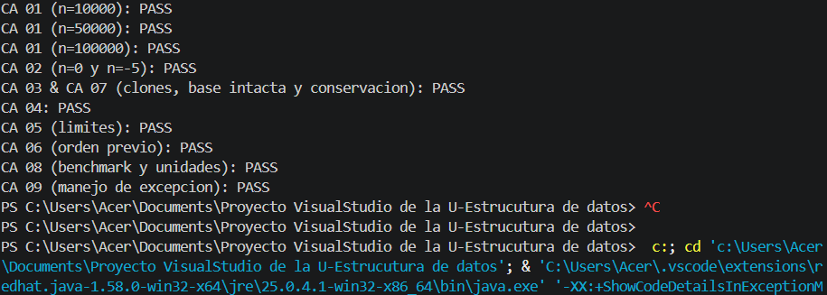

# Evidencias de Pruebas de Aceptacion — PL1.1

Las pruebas funcionales, casos limite y manejo de errores se ejecutan por separado mediante `PruebasAceptacion` y no agregan registros a la lista de los 12 tiempos del benchmark principal.

| ID | Operacion / Entrada | Resultado esperado | Resultado real | Estado | Referencia a la evidencia |
| :--- | :--- | :--- | :--- | :--- | :--- |
| CA 01 | `Generador.generate(n)` con `n = 10000, 50000, 100000` | Arreglos de longitud `n` con enteros en `[0, n]` inclusive | `CA 01 (n=10000): PASS`, `CA 01 (n=50000): PASS`, `CA 01 (n=100000): PASS` | PASS | `pruebas_de_aceptacion.png` |
| CA 02 | `Generador.generate(0)` y `Generador.generate(-5)` | Arreglo vacio para `0`; excepcion explicita (`IllegalArgumentException`) para `-5` | `CA 02 (n=0 y n=-5): PASS` | PASS | `pruebas_de_aceptacion.png` |
| CA 03 | Preparar entradas de V1–V4 desde la misma muestra base | Mismos valores y orden inicial; clones independientes del original y entre si | `CA 03 & CA 07 (clones, base intacta y conservacion): PASS` | PASS | `pruebas_de_aceptacion.png` |
| CA 04 | Ordenar `[7, 2, 7, 0, 4, 2]` con V1–V4 | `[0, 2, 2, 4, 7, 7]` en las cuatro variantes | `CA 04: PASS` | PASS | `pruebas_de_aceptacion.png` |
| CA 05 | Ordenar `[]`, `[5]` y `[3, 3, 3]` con V1–V4 | `[]`, `[5]` y `[3, 3, 3]` sin errores | `CA 05 (limites): PASS` | PASS | `pruebas_de_aceptacion.png` |
| CA 06 | Ordenar `[0, 1, 2, 3]` y `[3, 2, 1, 0]` con V1–V4 | `[0, 1, 2, 3]` en ambos casos | `CA 06 (orden previo): PASS` | PASS | `pruebas_de_aceptacion.png` |
| CA 07 | Ejecutar todas las variantes desde la misma base | Base intacta; salidas coinciden por valor con copia ordenada fuera del cronometro | `CA 03 & CA 07 (clones, base intacta y conservacion): PASS` | PASS | `pruebas_de_aceptacion.png` |
| CA 08 | Medir operacion mediante lambda con `Benchmark.medir` | Objeto `Results` con nombre, `sample` real y duracion coherente en `ns` y `ms` agregado tras validar | `CA 08 (benchmark y unidades): PASS` | PASS | `pruebas_de_aceptacion.png` |
| CA 09 | Enviar operacion que lanza excepcion a `Benchmark.medir` | Fallo identificable con causa original; no se registra como ejecucion exitosa | `CA 09 (manejo de excepcion): PASS` | PASS | `pruebas_de_aceptacion.png` |
| CA 10 | Completar mediciones (V1–V4 en `10.000`, `50.000` y `100.000`) e imprimir lista | 12 resultados en consola; coincidencia entre impresion final, capturas y tabla del `README.md` | 12 registros impresos al finalizar en `App.java` | PASS | `12_resultados.png`, `resumen_en_milisegundos.png` y `README.md` |
| CA 11 | Revisar metodo investigado (`sortMerge`) y su traza sobre `[7, 2, 7, 0, 4, 2]` | Codigo, traza y documento describen la misma variante; salida `[0, 2, 2, 4, 7, 7]` | Traza verificada con salida `[0, 2, 2, 4, 7, 7]` | PASS | `Metodos.java` (`sortMerge`) e `Investigacion.md` |